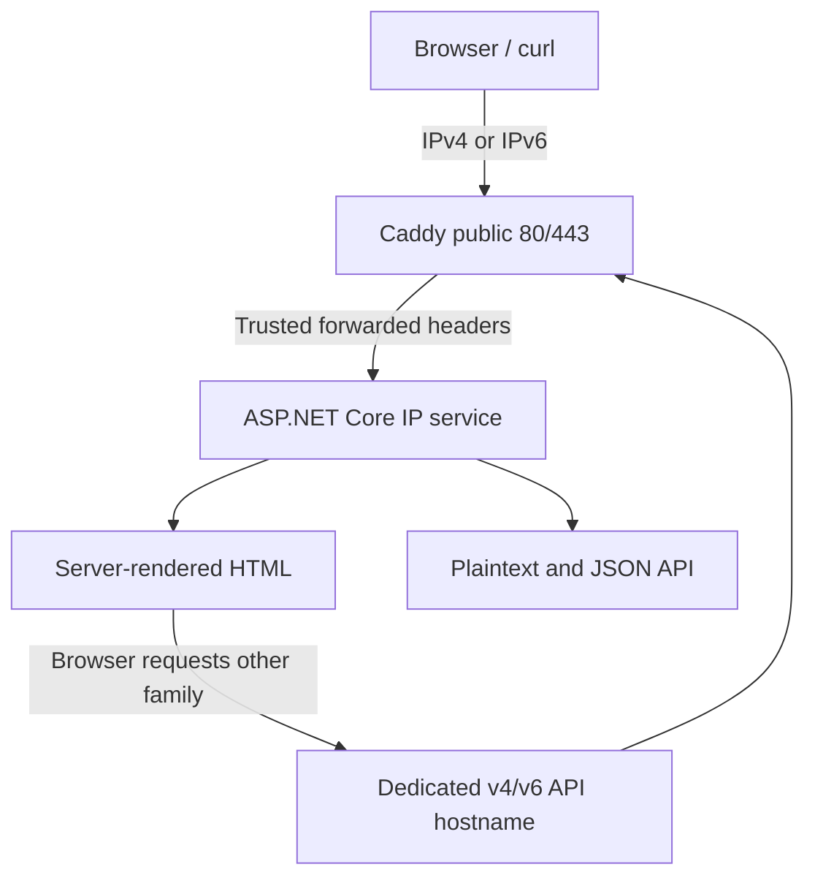

# PrivacyLink IP - Product & Technical Specification

**Status:** Ready for implementation planning  
**Version:** 1.0  
**Date:** 2026-11-21  
**Project:** PrivacyLink IP (working name)  
**Canonical URL:** `https://ip.privacylink.nl`  
**Repository:** New, independent GitHub repository (name to be chosen)  
**Target implementer:** Codex / .NET developer  
**Language:** Dutch product copy initially; English identifiers, code and API contracts

> **Purpose of this document:** A self-contained, executable specification. The implementation agent should use the explicit requirements and acceptance criteria below, not invent features or change the agreed architecture without recording a decision. Items marked **MVP** are the first release; all other features are **post-MVP**.

---

## 1. Productvisie

PrivacyLink IP is een extreem snelle, advertentievrije en privacyvriendelijke website om het **publieke IPv4- en IPv6-adres van de bezoeker** te tonen en te kopieren. De bezoeker krijgt direct een bruikbaar resultaat; aanvullende netwerkgegevens verschijnen asynchroon wanneer ze beschikbaar zijn.

De primaire gebruikssituatie is: "Ik heb nu mijn publieke IP-adres nodig en wil het zonder gedoe kopieren."

De dienst is zelfstandig ontwikkeld en open source. De branding en hosting vallen voorlopig onder `privacylink.nl`, maar de code, releasecyclus en deployment zijn onafhankelijk van de hoofdapplicatie PrivacyLink.

### 1.1 Kernprincipes

1. **IP first:** het adres van de verbinding waarmee de hoofdpagina is geladen staat al in de eerste HTML-response.
2. **Beide families:** toon, indien bereikbaar, zowel IPv4 als IPv6. Voor het tweede adres is maximaal **een aanvullende IP-detectie-request** nodig.
3. **Direct bruikbaar:** beide adressen hebben ieder een eigen knop om te kopieren; copy werkt direct zodra een adres bekend is.
4. **Progressive enhancement:** aanvullende gegevens laden asynchroon en blokkeren nooit de IP-weergave.
5. **Geen rommel:** geen advertenties, account, cookie-popups, trackers, paywalls of onnodige UI-elementen. Extra informatie mag zichtbaar zijn, zolang prioriteit en visuele hierarchie duidelijk blijven.
6. **Privacy by design:** geen permanente opslag van bezoekers-IP's en geen externe browser-side telemetrie.
7. **Open, klein, onderhoudbaar:** geen onnodige frameworks, database, microservices of gedeelde PrivacyLink-code.
8. **Eerlijkheid:** onderscheid tussen werkelijk gemeten verbindingseigenschappen en schattingen. Onbekend of onbereikbaar is geen "niet ondersteund".

### 1.2 Doelgroepen

- Algemene gebruiker die een IP-adres wil zien of delen.
- Softwareontwikkelaar of beheerder die snel een adres of API-response nodig heeft.
- Netwerkbeheerder die snel zijn verbinding, adresfamilie, provider of DNS wil onderzoeken (vooral na MVP).

### 1.3 Meetbare succescriteria

- Bij werkende hoofdverbinding staat het eerste adres in server-rendered HTML zonder client-side JavaScript.
- Indien de andere IP-familie bereikbaar is, verschijnt die automatisch, zonder herladen.
- Er zijn geen gebruikersaccounts, advertenties, trackingcookies of externe UI-scripts.
- Bij fouten is het eerste adres bruikbaar; het tweede adres krijgt een duidelijke status en retry-optie.
- De public API is ook zonder browser bruikbaar met `curl`.
- De website en API geven geen door de gebruiker vervalst `X-Forwarded-For`-adres weer.

---

## 2. Scope en fasering

### 2.1 MVP - eerste publieke release

**MVP-01** Server-side renderen van het door de backend waargenomen publieke IP van het initiële paginaverzoek.

**MVP-02** IPv4 en IPv6 als twee vaste UI-secties, met aparte "Copy"-knoppen.

**MVP-03** Browser haalt na renderen uitsluitend de **ontbrekende IP-familie** op via het bijbehorende v4- of v6-endpoint. Nooit beide opvragen als de eerste familie al bekend is.

**MVP-04** Onafhankelijke foutstatussen: loading, available, unavailable, timeout, retrying. De eerste familie wordt niet gewist als de tweede mislukt.

**MVP-05** Publieke plaintext-API voor IPv4, IPv6 en dual-stack clients, plus JSON-variant.

**MVP-06** Minimalistische, responsive, toegankelijke interface; dark/light via systeemvoorkeur.

**MVP-07** Geen advertenties, tracking of bezoekers-IP-logging; heldere privacytekst.

**MVP-08** Basale operationele zaken: healthcheck, HTTPS, Docker, Caddy, GitHub Actions, tests, README.

**MVP-09** Robuuste proxy- en IP-family-validatie met een expliciete fail-closed fout indien de netwerkconfiguratie een verkeerd adres oplevert.

**MVP-10** Heldere status van IPv4-/IPv6-bereikbaarheid in de browser, zonder te suggereren dat een mislukte test bewijst dat de ISP geen IPv6 ondersteunt.

**Niet in MVP:** geolocatie, ASN, provider, reverse DNS, DNS-tools, RDAP, monitoringdashboard, user accounts, database, IP-history, WebRTC-leaktest, poortscanner, betaalde API, CLI-package.

### 2.2 Post-MVP: fase 1 - IP-verrijking

- ASN, AS-organisatienaam / provider (waar beschikbaar).
- Land en mogelijk regio/stad via IP-geolocatie, met zichtbaar label "geschat".
- Reverse DNS (PTR), asynchroon, met expliciete timeout.
- Een knop "Copy all" en "Copy JSON" voor de beschikbare gegevens.
- Optionele gegevens: CIDR/registry, routability en type adres, mits betrouwbaar vast te stellen.
- Lokale (server-side) data-bron voor Geo-IP/ASN, geen browser-to-third-party calls.
- Dataherkomst, datum laatste database-update en duidelijke status bij ontbrekende gegevens.

### 2.3 Post-MVP: fase 2 - netwerktoolbox

- Lookup van **een opgegeven IPv4-/IPv6-adres** (metadata, ASN, RDAP).
- DNS-lookup voor opgegeven hostname: A, AAAA, MX, TXT, CAA, NS, SOA, PTR.
- Subnet/CIDR-calculator voor IPv4 en IPv6.
- HTTP-request/headers-uitleg voor de eigen browserrequest (beperkte, zorgvuldig gekozen headers).
- Dedicated URLs per tool; extra informatie hoeft niet van de homepage verwijderd te worden, maar blijft secundair aan de twee IP-adressen.
- Inputvalidatie, throttling en SSRF-beveiliging zijn voorwaarden voor publieke lookup-tools.

### 2.4 Post-MVP: fase 3 - geavanceerde diagnostiek (verkenning, geen toezegging)

- IPv4-/IPv6-connectiviteitstest met duidelijkere diagnose.
- DNS-lekdetectie, alleen als een verifieerbaar, betrouwbaar protocol met eigen testinfra wordt ontworpen.
- WebRTC-adreslekcontrole, uitsluitend met duidelijke opt-in en browserbeperkingen vermeld.
- TCP-poortbereikbaarheidstest op een beperkt, veilig model (geen willekeurige open proxy/portscanner).
- API-documentatie/OpenAPI, abuse controls, eventueel versiebeleid.
- Multilingual UI indien relevant.

---

## 3. URL's, DNS en protocolkeuze

De drie hostnames wijzen naar **dezelfde Caddy-instance en dezelfde ASP.NET Core-container**. Het DNS-record van de hostname begrenst welke adresfamilie de client normaal kan gebruiken.

| Hostname | DNS | Rol |
| --- | --- | --- |
| `ip.privacylink.nl` | A + AAAA | Canonieke homepage en dual-stack API |
| `v4.ip.privacylink.nl` | Alleen A | IPv4-only detectie-API |
| `v6.ip.privacylink.nl` | Alleen AAAA | IPv6-only detectie-API |

### 3.1 Verplichte DNS-vereisten

- De A-records verwijzen naar het publieke IPv4-adres van de VPS.
- De AAAA-records verwijzen naar het publieke IPv6-adres van de VPS.
- Publiceer op v4 **geen** AAAA en op v6 **geen** A, inclusief impliciete records door CNAME-flattening of andere DNS-features.
- Controleer ook CNAME-, HTTPS- en SVCB-records en clientgedrag: publiceer geen alternatieve routes/hints die het beoogde protocol omzeilen.
- Als de zone via Cloudflare wordt beheerd: gebruik in de MVP **DNS-only** voor deze drie hostnames. Een geproxied Cloudflare-record kan automatisch AAAA antwoorden genereren en de bezoeker ziet anders de CDN-hop tenzij de forwardingketen expliciet wordt vertrouwd.
- Zorg dat de VPS IPv4 en IPv6 werkelijk op TCP 80/443 accepteert; test zowel van buiten het netwerk als vanuit een dual-stack client.
- De DNS-regels bieden de normale protocolselectie; valideer daarnaast altijd op de backend welke adresfamilie werkelijk is waargenomen.
- Let op uitzonderingen door VPN, bedrijfsproxy, DNS64/NAT64, tunnels en browser-/netwerkpolicy. Meet "adres gezien door deze server", niet noodzakelijk het fysieke toesteladres.

### 3.2 Requestflow

**Scenario A: homepage komt via IPv4 binnen**

1. Browser doet `GET https://ip.privacylink.nl/` via IPv4.
2. Caddy stuurt de request door naar de app, inclusief een betrouwbare client-IP-forwardingketen.
3. De app bouwt HTML met IPv4 reeds zichtbaar en IPv6 op `loading`.
4. Browser doet precies een extra IP-request: `GET https://v6.ip.privacylink.nl/api/ip`.
5. De response levert het **IPv6-adres dat de server op die tweede request waarneemt**; UI vult IPv6 in.

**Scenario B: homepage komt via IPv6 binnen**

Identiek, maar stap 3 bevat IPv6 en stap 4 vraagt `https://v4.ip.privacylink.nl/api/ip` op.

**Scenario C: tweede protocol niet bereikbaar**

Eerste adres blijft beschikbaar; tweede toont "Niet bereikbaar via deze browser" (of vergelijkbaar), met "Opnieuw proberen". Geen oneindige spinner en geen onterechte conclusie over ISP-support.

**Scenario D: eerste protocol onbetrouwbaar/niet vast te stellen**

Toon geen gok. De backend registreert een algemene fout zonder client-IP in permanente logs. De UI mag een neutrale fout tonen en, als eenvoudige fallback, beide specifieke hosts proberen. Dit is geen standaardpad en vereist tests.

### 3.3 Zelfde website versus zelfde hostname

- Dit is **dezelfde applicatie en hetzelfde product**.
- De tweede fetch gebruikt **een andere hostname**, zodat DNS de relevante IP-familie kan selecteren.
- `https://ip.privacylink.nl/api/ipv4` op de dual-stack hostname forceert **geen** IPv4; een URL-pad kan de DNS-resolutie en socket-family niet bepalen.
- `v4.*` en `v6.*` zijn andere origins. CORS moet browserrequests vanaf de canonieke origin toestaan.

---

## 4. Functionele requirements en acceptatiecriteria

### 4.1 IP-weergave (MVP)

**FR-01: Initial IP in HTML**

- De server levert `text/html; charset=utf-8`.
- Het initieel waargenomen adres staat als gewone tekst in de HTML op de juiste IPv4- of IPv6-regel.
- JS is **niet** nodig om dit eerste IP zichtbaar te maken.
- De IP-adressen worden server-side correct ge-escaped wanneer ze in HTML worden ingevoegd.
- Geen kortstondig leeg scherm dat wacht op een API-call.

**Acceptance:** `curl -4 https://ip.privacylink.nl/` bevat een zichtbaar IPv4-adres; `curl -6` bevat het IPv6-adres, bij bereikbaarheid vanaf de testclient.

**FR-02: Second-family detection**

- De browser voert alleen een fetch uit naar de ontbrekende familie, geen dubbele detectie-fetch naar beide.
- Fetch onmiddellijk na initialisatie, onafhankelijk van metadata-taken.
- Client timeout: startwaarde **3 seconden** (configureerbaar); UI biedt retry.
- De response wordt gevalideerd met `IP address` parsing en gecheckt op de verwachte familie.
- Een fout wordt niet als een succesvolle detectie getoond.

**Acceptance:** Network tab toont voor adresdetectie maximaal een extra API-request naast de initiële documentrequest. Dit telt eventuele statische assets niet mee.

**FR-03: Copy**

- Iedere familie een eigen "Copy"-knop; pas enabled zodra waarde aanwezig.
- Clipboard API waar beschikbaar, met veilige fallback of begrijpelijke foutmelding.
- Visuele (en via live-region toegankelijke) bevestiging bij succes; geen claim bij mislukking.
- Kopieer de kale IP-string, dus zonder label, spaties of haakjes.
- Na retry blijven reeds bestaande gekopieerde adressen zichtbaar.

**Acceptance:** plakken geeft exact het getoonde IP-adres.

**FR-04: Stable layout and statuses**

- Beide regels hebben vanaf de start een gereserveerde plek; minimale layout shift.
- Statusmodel per familie: `loading`, `available`, `unavailable`, `timeout`, `error`.
- De status "Not available" is diagnostisch voorzichtig: een browserfout bewijst niet de oorzaak.
- Voorkom verschuivingen door lange IPv6-adressen: wrapping/copy button werkt op een mobiel scherm.

**Acceptance:** bij geblokkeerde v6-request blijft IPv4 werken; herstel na retry werkt zonder reload.

**FR-05: Direct API**

- De API werkt zonder JavaScript en zonder cookies.
- Het adres is altijd het door de server waargenomen publieke clientadres, rekening houdend met geconfigureerde vertrouwde proxies.
- API's voor geforceerde family weigeren resultaten van een andere family in plaats van foutief te labelen.

**FR-06: Privacy & eenvoud**

- Geen advertenties, cookie-banner, externe fonts, Google Analytics, trackers of scripts van derden.
- Homepage heeft een korte, duidelijke privacyboodschap en link naar uitgebreide toelichting.
- Geen accounts of persoonsgegevens nodig.

### 4.2 Concrete MVP schermindeling

```text
PrivacyLink IP                                    No ads. No tracking.

Your public IPv4
203.0.113.42                                        [Copy]

Your public IPv6
2001:db8:85a3::8a2e:370:7334                      [Copy]

Connection: IPv4 + IPv6 available

[More details - optional / async, post-MVP]

About / Privacy / API / Source code
```

De voorbeeldadressen zijn RFC-documentatieadressen, geen werkelijke detectieresultaten.

**UX-regels:**

- Bezoekers begrijpen binnen enkele ogenblikken waar de waarde staat en hoe ze die kopieren.
- Geen modal, tab, splashscreen, onboarding of grote hero-banner.
- Desktop en mobile hebben dezelfde functies.
- Voorkeur: weinig afhankelijkheden, kleine CSS-bundel, eenvoudige semantische HTML.
- Respecteer `prefers-color-scheme` en `prefers-reduced-motion`.
- Geen automatische copy bij paginalaad; alleen na expliciete interactie.
- Bij niet-werkende JavaScript blijft het initial IP zichtbaar en kopieerbaar via tekstselectie; optioneel gewone server-rendered link voor het andere family endpoint.

---

## 5. HTTP API - MVP-contract

De API is public, stateless, gratis en heeft geen sleutel nodig. Versiebeleid v1 is impliciet in de URL, tenzij later meer onderhoud nodig blijkt.

### 5.1 `GET /api/ip` - plaintext

**Hostnames:** alle drie.

**Response bij succes:**

```http
HTTP/1.1 200 OK
Content-Type: text/plain; charset=utf-8
Cache-Control: no-store

203.0.113.42
```

- Precies een IP-string plus een enkele trailing newline (`\n`), geschikt voor CLI-tools.
- Geen HTML, dubbele quotes of extra metadata.
- Ongeacht request-header `Accept`, tenzij een latere API-versie dit bewust wijzigt.
- `v4` geeft alleen een IPv4-adres terug; `v6` alleen een IPv6-adres.
- Hoofddomein retourneert de versie van **deze request**.

### 5.2 `GET /api/ip.json` - JSON

**Hostnames:** alle drie.

**Response bij succes:**

```json
{
  "ip": "203.0.113.42",
  "version": 4
}
```

- `ip`: string, genormaliseerd formaat.
- `version`: integer `4` of `6`.
- Geen ASN/provider/geo in MVP-contract.
- Stabiele, exacte propertynamen; uitbreidingen alleen additive.

### 5.3 `GET /healthz`

- `200 OK` als het appproces requests kan afhandelen.
- **Niet** afhankelijk maken van externe Geo-IP-servers of DNS.
- Geen identificerende gebruikersdata teruggeven.
- Geschikt voor container-healthcheck; bij voorkeur alleen via het interne Docker-netwerk, niet nodig als publiek dashboard.

### 5.4 Onjuiste family / interne fouten

Indien de backend op `v4.*` een IPv6-adres ziet of op `v6.*` een IPv4-adres:

- **Geen `200` met verkeerd IP.**
- Status `503 Service Unavailable`, JSON-foutcode `ip_family_mismatch` voor de JSON-endpoint; plaintext mag een korte fout geven.
- Log een niet-identificerende operationele gebeurtenis (geen bezoekers-IP).
- Diagnose/test faalt; misconfiguratie moet worden gerepareerd.

Voor overige fouten: niet-diagnostische response zonder stacktrace, request-IP of gevoelige interne details.

### 5.5 Cross-origin access

- `GET` vanaf origin `https://ip.privacylink.nl` naar `v4.*` / `v6.*` moet door de browser gelezen kunnen worden.
- Aanbevolen `Access-Control-Allow-Origin: https://ip.privacylink.nl` op de v4- en v6-API's.
- Geen cookies/credentials; client doet `credentials: 'omit'`.
- Geen preflight-afhankelijkheid voor een normale eenvoudige GET zonder custom headers.
- CORS is **geen authenticatie**; publieke CLI-toegang blijft toegestaan vanaf andere clients.
- Overweeg `Access-Control-Allow-Origin: *` uitsluitend als expliciete keuze voor volledig publiek browser-embedbare API; MVP kiest de smallere originallowlist.

### 5.6 Cache, security headers en methods

- Voor **alle responses met een afgeleid bezoekers-IP**: `Cache-Control: no-store`; geen CDN/shared caching.
- Ook de dynamische HTML-homepage en toekomstige `/api/info` mogen niet gecachet worden.
- Statische CSS/JS-assets mogen lang gecachet worden met content-hash/fingerprint in bestandsnaam.
- `X-Content-Type-Options: nosniff`; relevante `Referrer-Policy`, `Content-Security-Policy` en `Permissions-Policy`.
- CSP minimaal geschikt voor eigen scripts/styles en `connect-src 'self' https://v4.ip.privacylink.nl https://v6.ip.privacylink.nl`; geen onnodige inline scripts.
- HTTPS verplicht, redirect HTTP naar HTTPS.
- HSTS eerst conservatief per hostname; **geen** `includeSubDomains` of preload zonder beoordeling van de gehele `privacylink.nl`-zone.
- `GET` / `HEAD` ondersteunen; overige methods op readonly-endpoints geven `405`.
- Geen externe redirect in API of client-JS.
- Vermijd `ETag`/`Last-Modified` voor responses met persoonlijk IP-adres.

### 5.7 Voorbeelden voor README

```bash
# Dual-stack: de adresfamilie van de verbinding die curl kiest
curl -sS https://ip.privacylink.nl/api/ip

# Forceer een IPv4-pad via DNS
curl -sS https://v4.ip.privacylink.nl/api/ip

# Forceer een IPv6-pad via DNS
curl -sS https://v6.ip.privacylink.nl/api/ip

# JSON
curl -sS https://v4.ip.privacylink.nl/api/ip.json

# Test expliciet het netwerkprotocol van het hoofddomein
curl -4 -sS https://ip.privacylink.nl/api/ip
curl -6 -sS https://ip.privacylink.nl/api/ip
```

`curl -6` faalt uiteraard op een client zonder bruikbare IPv6-connectiviteit.

---

## 6. Technische architectuur

### 6.1 Gekozen stack

| Onderdeel | Keuze |
| --- | --- |
| Backend | ASP.NET Core / .NET **10 LTS** |
| Appmodel | Minimal API + kleine server-side HTML-template renderer |
| Frontend | Semantische HTML, vanilla CSS, kleine vanilla JavaScript-module |
| Reverse proxy | Bestaande Caddy-instance |
| Container | Afzonderlijke Docker-image en service |
| Hosting | Bestaande Debian VPS (naast maar onafhankelijk van PrivacyLink) |
| CI/CD | Eigen GitHub repository, eigen GitHub Actions workflow |
| Database | Geen |
| Externe API's | Geen in MVP |
| Lokale Geo-IP/ASN-database | Pas na MVP |

**Waarom .NET 10:** op het moment van deze spec is .NET 10 LTS ondersteund; .NET 8 en .NET 9 hebben inmiddels hun support-end bereikt. Pinnen op ondersteunde patchversies. Het model is bewust simpel gehouden om later technisch los van PrivacyLink te blijven.

### 6.2 Componentgrenzen



**Deploy:** Caddy is de gedeelde edge-proxy; de IP-tool draait als eigen service, op een intern netwerk, zonder publiek gepubliceerde apppoort.

### 6.3 IP-identificatie achter Caddy - securitykritisch

De ASP.NET Core-container ziet als directe peer meestal **Caddy**, niet de internetbezoeker. Daarom:

1. Caddy ontvangt de publieke verbinding en zet standaard de relevante `X-Forwarded-*`-gegevens voor de backend.
2. ASP.NET Core `UseForwardedHeaders()` draait vroeg in de pipeline, met `XForwardedFor` en `XForwardedProto`.
3. De app vertrouwt **alleen expliciet bekende Caddy-proxy-IP's of een strikt afgebakend Docker-subnet** (of een veilig Unix-socket-alternatief indien beschikbaar).
4. Backend is niet rechtstreeks vanaf internet bereikbaar.
5. Onbetrouwbare inkomende `X-Forwarded-For` en soortgelijke headers mogen het resultaat niet kunnen vervalsen. Voeg geen fallback toe die blind de eerste forwarded header leest.
6. Als Docker de proxy-adressen wijzigt, configureer een stabiel afgebakend netwerk of valideer bij deploy de juiste vertrouwde range. Vertrouw nooit gemakshalve alle netwerken.
7. Als later een CDN of extra proxy wordt toegevoegd, documenteer en test de **volledige trust chain** opnieuw.
8. Beperk het aantal proxyhops (normaliter 1) en maak de Host-allowlist expliciet.

**Belangrijk:** nieuwere ASP.NET Core-versies negeren forwarded headers van niet-geconfigureerde proxies. Een configuratiefout kan daardoor het **interne container-IP** tonen. De implementatie moet dit fail-closed behandelen en expliciet testen.

### 6.4 Backend-IP-regels

- Verkrijg de client-IP via de veilig geconfigureerde `HttpContext.Connection.RemoteIpAddress` na forwarded-header middleware.
- Normaliseer IPv4-mapped IPv6 (zoals `::ffff:192.0.2.1`) tot IPv4 indien passend.
- Behoud echte IPv6-adressen; compact representeren mag met standaard .NET-formattering.
- Nooit een poortnummer of IPv6-brackets in de te kopieren waarde.
- De v4-/v6-hostname wordt gecontroleerd met een exacte allowlist, niet met een onveilige suffixmatch.
- Als een adres ontbreekt of onbetrouwbaar is, geen netwerk-IP of proxy-IP als publiek bezoekers-IP tonen.
- De API legt uit dat een VPN/proxy/NAT de zichtbare waarde kan veranderen.
- Een IPv6 privacy extension address kan tussen verzoeken veranderen; de UI toont de momentopname van elke request.

### 6.5 Server-side rendering

Voorkeursimplementatie: een statische, gecompileerde of startup-geladen HTML-template waarin een kleine, gesanitiseerde server-side modelwaarde wordt ingevuld. Geen client-side SPA en geen template-engine/framework verplicht.

Alternatief: Razor Pages als dat eenvoudiger/veiliger blijkt; **voorkom eigen onveilige stringconcatenatie**. Leg een afwijking kort vast in een ADR.

Bijvoorbeeld server-model:

```json
{
  "initialIp": "203.0.113.42",
  "initialVersion": 4,
  "otherVersion": 6
}
```

Initial server-state wordt veilig opgenomen in HTML-attributen/data of een minimaal JSON-scriptblok (met correcte encoding). Het zichtbare initiele IP staat al in de HTML; JavaScript start uitsluitend de detectie van de ontbrekende family.

### 6.6 JS-algoritme (functioneel pseudocode)

```text
onDOMContentLoaded:
  initial = getServerRenderedInitialIpAndFamily()
  assert initial parses and family matches
  show initial (already rendered; do not replace unnecessarily)

  otherFamily = (initial.version == 4 ? 6 : 4)
  otherEndpoint = (otherFamily == 4)
    ? 'https://v4.ip.privacylink.nl/api/ip'
    : 'https://v6.ip.privacylink.nl/api/ip'

  setStatus(otherFamily, loading)
  request otherEndpoint with credentials omitted, cache disabled,
    timeout 3000ms and no redirects
  if valid response of expected family:
     show response IP and enable Copy
  else:
     show honest error/timeout status and Retry

  do not block future metadata requests on this flow
```

### 6.7 Indicatieve Caddy-configuratie

Caddy draait bij voorkeur buiten deze repository als onderdeel van de bestaande VPS-edge-configuratie. Dit fragment is een **integratiesjabloon**, niet automatisch de definitieve configuratie; pas container-service en netwerk aan de bestaande deployment aan.

```caddyfile
ip.privacylink.nl, v4.ip.privacylink.nl, v6.ip.privacylink.nl {
    encode zstd gzip
    reverse_proxy privacylink-ip:8080
}
```

- Caddy regelt HTTPS voor alle drie hostnames.
- Gebruik **geen** onnodige `bind` per family op een gedeelde 443-listener; DNS regelt de family-selectie.
- Caddy moet zelf publiek over beide address families bereikbaar zijn.
- Caddy-container en app-container communiceren op een gedeeld, afgeschermd Docker-netwerk.
- Voeg configuratie toe zonder de bestaande PrivacyLink-route te wijzigen.
- Caddy's reguliere access logging voor deze hostnames mag geen bezoekers-IP's permanent opslaan (geen `log`-directive, of privacyveilige geaggregeerde configuratie).

### 6.8 Docker / deployment

- Eigen multi-stage Dockerfile voor .NET 10, kleine runtime-image, non-root proces waar haalbaar.
- Eén appcontainer; database of Redis niet introduceren.
- Backend luistert intern op poort `8080`; niet met `ports: 8080:8080` publiek publishen.
- Compose-service kan via external Docker-network aan bestaande Caddy worden gekoppeld.
- Healthcheck `GET /healthz` via intern adres; test uitvoerbaarheid van de gekozen healthcheck-tool in de image.
- Restart policy passend bij VPS-beheer; resource limits waar praktisch.
- Rolling/atomic deployment zonder onderbreking indien bestaande setup dat ondersteunt; voorkom wijzigingen aan hoofdapplicatie.
- Secrets zijn niet nodig in MVP; toekomstige Geo-IP-updatecredentials zijn wel GitHub/VPS-secrets.

### 6.9 Repository-indeling (voorstel)

```text
privacylink-ip/
  README.md
  LICENSE
  SPEC.md                      # deze specificatie
  docs/
    architecture.md
    deployment.md
    privacy.md
    adr/
  src/
    PrivacyLink.Ip/
      PrivacyLink.Ip.csproj
      Program.cs
      Services/
        ClientIpResolver.cs
      Web/
        index.html
        assets/
          site.css
          site.js
  tests/
    PrivacyLink.Ip.Tests/
      PrivacyLink.Ip.Tests.csproj
  deploy/
    Dockerfile
    compose.example.yml
    Caddyfile.example
  .github/
    workflows/
      ci.yml
      deploy.yml
```

Deze structuur is richtinggevend. Codex mag eenvoudige bestanden samenvoegen als dat onderhoudbaarheid en testbaarheid verbetert, maar geen grote multi-projectarchitectuur introduceren zonder reden.

---

## 7. Niet-functionele requirements

### 7.1 Performance

**Doelstellingen (te meten, niet blind garanderen):**

- HTML bevat het eerste IP zonder extra netwerk-roundtrip.
- Initial document is klein (richtwaarde < 25 KB ongecomprimeerd, exclusief assets).
- Totale eerste paginaassets lichtgewicht (richtwaarde < 75 KB compressed, zonder browsercache).
- Geen third-party scripts, fonts of blokkende calls.
- Time-to-first-byte richtwaarde < 200 ms vanaf een Nederlandse testlocatie onder normale omstandigheden (geen SLA).
- Second-family request start direct na de eerste render en heeft standaard een time-out van 3 sec.
- Metadata, wanneer later toegevoegd, mag eerste IP, copy en andere-family detectie niet blokkeren.
- Vermijd extra requests puur voor metadata die nog niet op de pagina gebruikt wordt.

### 7.2 Responsiveness en toegankelijkheid

- Werkend op 320px breed en groter; ook lange IPv6-adressen passen of breken netjes af.
- Keyboard-only bedienbaar; zichtbare focus, labels, semantische landmarks.
- Contrast minimaal WCAG 2.2 AA als ontwerpdoel.
- ARIA live-region voor copy-feedback en async status; geen overmatig screenreader-spam.
- Systeem-light/dark, met consistente lay-out en geen zware animaties.
- UI blijft zinvol als JS uitgeschakeld is.

### 7.3 Browser- en protocolcompatibiliteit

- Moderne Chrome, Edge, Firefox, Safari (desktop en mobiel).
- HTTP/1.1, HTTP/2 en HTTP/3 mogen door Caddy worden gebruikt; de app vertrouwt op de waargenomen remote client-IP.
- Beperk afhankelijkheden van specifieke browser-API's.
- Test afzonderlijk netwerken met IPv4-only, IPv6-only en dual-stack.
- Als clients door NAT64/bedrijfsproxy gebruikmaken van een protocoltranslator, kan de waargenomen "IPv4" van een gateway komen; documenteer dat correct.

### 7.4 Observability zonder tracking

Toegestaan:

- procesmetrics: uptime, readiness, CPU/memory, statuscodeaantallen, gemiddelde latency;
- geaggregeerde niet-herleidbare counters (bijv. succes/fout per endpoint), bij voorkeur zonder IP-labels;
- niet-identificerende foutlogging (bijv. `ip_family_mismatch`, exceptiontype zonder request-IP).

Niet toegestaan zonder nieuw privacybesluit:

- individuele requestlogs met volledige client-IP;
- persistente IP-history;
- user IDs, fingerprinting, cross-site tracking;
- logging van complete requestheaders, URL-queries met persoonsgegevens of HTTP-body's;
- externe analytics-SDK's in de browser.

Controleer zowel **Caddy**, ASP.NET Core, Docker logdriver, hostingprovider als eventuele security-/firewalllogs. De privacyclaim moet overeenkomen met de echte configuratie; niet impliceren dat de VPS-provider nooit netwerkmetadata ziet.

### 7.5 Veiligheid

- Alleen HTTPS publiek; actuele TLS-instellingen van Caddy.
- Geen trust voor ongevalideerde forwarded headers.
- Host allowlist en strict family validation.
- Geen secrets/client-IP in server error pagina's.
- Alleen eigen scripts/styles; passende CSP en securityheaders.
- Dependency updatebeleid, Dependabot/Renovate optioneel, GitHub code scanning.
- Rate limiting alleen als aantoonbaar nodig; als geïmplementeerd: geen persistente individuele IP-tracking vereist.
- Geen server-side fetching van door bezoeker opgegeven URL's in MVP.
- Securitytests voor spoofed headers, Host-header attacks, caching en HTML escaping.

---

## 8. Privacybeleid / publiek vertrouwen

De website communiceert duidelijk:

> "We show the IP addresses our servers see when your browser connects. We don't run ads, set tracking cookies, or store a history of your IP address. Network providers and intermediate proxies may see connection metadata."

Nederlandse vertaling mogelijk in de UI. Controleer deze tekst voor publicatie tegen echte infrastructuur en logconfiguratie.

**Privacy-pagina bevat minimaal:**

- Welke gegevens worden verwerkt tijdens een netwerkverbinding (waaronder IP om antwoord te kunnen geven).
- Waarom de gegevens technisch nodig zijn.
- Wat niet wordt opgeslagen door de applicatie.
- Eventuele beperkte logs van infrastructuurproviders of bescherming tegen misbruik, inclusief bewaartermijn indien van toepassing.
- Cookies/tracking: geen (voor zover feitelijk juist).
- Contactinformatie en link naar source repository.
- Als Geo-IP later toegevoegd wordt: bron, lokale verwerking en beperkte nauwkeurigheid.

**Open-source trust:** publiceer code, eenvoudige self-hostinstructies, release-tags en een security disclosure-route (`SECURITY.md` of equivalent). Niet claimen dat open source automatisch veiligheid garandeert.

---

## 9. Testplan en acceptatiematrix

### 9.1 Unit tests

- Herken IPv4, IPv6 en IPv4-mapped IPv6 correct.
- Normalizeer IP-output zonder port/brackets.
- Exacte hostname-allowlist voor v4, v6 en main.
- Mismatch `v4 hostname + IPv6 remote` => geen succesresponse.
- Mismatch `v6 hostname + IPv4 remote` => geen succesresponse.
- HTML-encoding tegen injectie via modelvelden.
- JSON-contract en text/plain newline.
- Timeout- en retry-state machine.

### 9.2 ASP.NET Core integration tests

- Simuleer een vertrouwde Caddy proxy: correcte remote IP na middleware.
- Spoofed `X-Forwarded-For` van een onbekende proxy wordt genegeerd.
- Malformed of multi-hop headers worden niet als willekeurige client-IP vertrouwd.
- App zonder forwarded-headerconfig geeft niet stilletjes interne RFC1918/container-IP's als publiek adres.
- `/api/ip` levert exact plain text; `/api/ip.json` exact verwacht schema.
- `Cache-Control: no-store` op HTML en alle IP-responses.
- V4/v6 CORS staat canonieke site toe, niet willekeurige credentialed requests.
- Host-headerinjectie en onbekende hostnames worden afgewezen.
- `/healthz` werkt zonder externe afhankelijkheden.

### 9.3 Browser/end-to-end tests

| Test | Verwachting |
| --- | --- |
| IPv4-only client | IPv4 direct zichtbaar, IPv6 krijgt eerlijke foutstatus |
| IPv6-only client | IPv6 direct zichtbaar; IPv4 waar mogelijk via NAT64/proxy, anders foutstatus |
| Dual-stack / initieel IPv4 | IPv4 direct + exact één request naar `v6.*` |
| Dual-stack / initieel IPv6 | IPv6 direct + exact één request naar `v4.*` |
| V6 endpoint timeout | V4 blijft beschikbaar, retry werkt |
| JavaScript uit | Initial IP staat in HTML |
| Clipboard toegestaan | Exact IP gekopieerd, succesfeedback |
| Clipboard geblokkeerd | Geen valse succesmelding, bruikbare fallback |
| 320px scherm | Adressen leesbaar, knoppen bereikbaar, geen horizontale scroll |
| Reduced motion / screenreader | Geen functionele regressies |

### 9.4 Real-world commandline checks

```bash
# Let op: voer dit uit vanaf een host met IPv4 én IPv6.
dig A ip.privacylink.nl +short
dig AAAA ip.privacylink.nl +short
dig A v4.ip.privacylink.nl +short
dig AAAA v4.ip.privacylink.nl +short
dig A v6.ip.privacylink.nl +short
dig AAAA v6.ip.privacylink.nl +short

curl -4 -v https://ip.privacylink.nl/api/ip
curl -6 -v https://ip.privacylink.nl/api/ip
curl -4 -v https://v4.ip.privacylink.nl/api/ip
curl -6 -v https://v6.ip.privacylink.nl/api/ip
```

**Expected DNS:** geen AAAA op `v4.*`, geen A op `v6.*`. Ook `HTTPS`/`SVCB` en ongewenste CNAME's controleren.

**Expected HTTP:** inhoud IP komt overeen met werkelijk waargenomen clientadres; protocol- en hostname-mismatch leveren geen foutief succesantwoord.

**Spoofingtest:** vergelijk de response met en zonder custom `X-Forwarded-For: 1.2.3.4`; dit mag niet het getoonde IP veranderen voor een internetclient.

**Cachetest:** twee verschillende externe clients mogen nooit elkaars IP-response ontvangen via gedeelde caching.

### 9.5 Release acceptance gate

De MVP mag alleen live wanneer:

- [ ] Alle MVP-eisen zijn geïmplementeerd.
- [ ] Unit/integratietests slagen in CI.
- [ ] DNS is geverifieerd voor A/AAAA/HTTPS/SVCB.
- [ ] TLS-certificaten zijn geldig op alle hostnames.
- [ ] Publieke HTTP IPv4/IPv6 is vanaf een extern netwerk getest.
- [ ] Geen backendpoort publiek bereikbaar.
- [ ] Trusted-proxy en spoofingtest zijn geslaagd.
- [ ] Geen foutieve proxy/container-IP's worden getoond.
- [ ] Geen IP-inhoud wordt gecachet.
- [ ] Privacyclaim en logging zijn gecontroleerd.
- [ ] Mobiele weergave en copy-functionaliteit zijn getest.
- [ ] Rollback-procedure is gedocumenteerd.

---

## 10. CI/CD en operationele beheervereisten

### 10.1 CI (`ci.yml`)

Bij pull request en op main:

1. `dotnet restore` met pinned SDK (via `global.json`).
2. Build met warnings waar relevant als errors.
3. Unit- en integratietests.
4. Format/lint checks.
5. Docker-image build (zonder deploy op PR).
6. Optioneel security scan en dependency check.

### 10.2 Deployment (`deploy.yml`)

- Onafhankelijke GitHub Actions deployment naar Debian VPS.
- Voorkeur: immutable getagde Docker-image, bijvoorbeeld Git SHA + versietag.
- Gebruik bestaande veilige VPS-deploymentconventies waar beschikbaar, maar maak **geen** koppeling met releaseworkflow van PrivacyLink zelf.
- GitHub Actions secrets / SSH key least privilege.
- Geen permanente secrets in repo of Dockerfile.
- Na deployment healthcheck en eenvoudige publieke smoke tests.
- Rollback naar de vorige image-tag mogelijk.
- Verstoringen in deze app mogen de hoofd-PrivacyLink-container niet beïnvloeden.

### 10.3 Runbook

Documenteer:

- DNS-aanmaken en controleren.
- Docker-network met bestaande Caddy.
- Caddyfile-reload en certificaatuitgifte.
- Deployment, logs zonder client-IP, healthcheck.
- IPv4/IPv6 checkcommando's.
- Problemen met forwardingconfiguratie.
- Rollback.
- Certificaatvernieuwing en netwerkfirewallchecks.

---

## 11. Backlog in implementatievolgorde

De subtaken zijn bewust klein genoeg voor afzonderlijke Codex-commits/PR's. Elke taak omvat tests en documentatie waar van toepassing.

### Milestone M0 - Foundation

- **M0-01:** Nieuwe repo maken, MIT/Apache-2.0-licentiekeuze vastleggen, README, .gitignore, SPEC.md.
- **M0-02:** .NET 10 Minimal API project plus tests en `global.json`.
- **M0-03:** Dockerfile, Compose-example, local run instructies.
- **M0-04:** GitHub Actions CI voor build/test/imagebuild.

### Milestone M1 - Correct IP detection

- **M1-01:** `ClientIpResolver` met IP-family-normalisatie en host-validation.
- **M1-02:** Veilige forwarded-header-configuratie met expliciete trusted proxy-instelling.
- **M1-03:** `GET /api/ip` en `/api/ip.json` (plain/JSON), cacheheaders, family-gating.
- **M1-04:** Unit/integration tests voor forwarded spoofing, wrong family, internal proxy IP.

### Milestone M2 - First-class homepage

- **M2-01:** Server-rendered HTML met het initial IP in de juiste familie.
- **M2-02:** Responsive design met twee IP-rijen en status-/copy-knoppen.
- **M2-03:** JS fetch naar alleen de andere familie, timeout, retry, strict parsing.
- **M2-04:** Browser clipboard en toegankelijkheidsfeedback.
- **M2-05:** Privacy-/about-/API-informatie en source link.

### Milestone M3 - Production ready

- **M3-01:** Caddyfile-example, DNS-plan, HTTPS, hostallowlist, CORS, CSP.
- **M3-02:** Docker-network en deployment integreren met bestaande VPS, zonder bestaande repo te wijzigen.
- **M3-03:** E2E/smoke tests voor IPv4 en IPv6, correct IP, spoofing en cache.
- **M3-04:** Deployworkflow, healthcheck en rollback.
- **M3-05:** UX/performance/accessibility/privacy review en public release.

### Milestone P1 - Post-MVP IP metadata

- **P1-01:** Selecteer lokale Geo-IP/ASN-databron en beoordeel licentie/redistributie/updatebeleid.
- **P1-02:** Implementatie server-side `IpMetadataService`, foutisolatie, eenvoudige cache met zorgvuldige privacyregels.
- **P1-03:** `GET /api/info` alleen voor de **huidige request-IP**, niet een willekeurige target.
- **P1-04:** UI-loaders voor provider/ASN/geo onafhankelijk van eerste twee IP-regels.
- **P1-05:** PTR met timeouts, capaciteitlimieten en presentatie van mislukte lookups.
- **P1-06:** "Copy all" en "Copy JSON" voor beschikbare velden.

### Milestone P2 - Post-MVP toolbox

- **P2-01:** IP-lookup inclusief RDAP en gedocumenteerde bronnen.
- **P2-02:** DNS-lookup met begrensde recordsets, TTL, timeouts en abuse controls.
- **P2-03:** IPv4-/IPv6-subnet/CIDR-calculator (puur lokaal indien mogelijk).
- **P2-04:** Header-/diagnostiekspagina met minimale, privacyveilige verwerking.

### Milestone P3 - Later evalueren

- Optionele uitgebreide connectiviteitstesten, DNS/WebRTC-lektests en strikt beperkte port-checks pas na aparte security- en privacy-ADR.

---

## 12. Post-MVP API-ontwerp (voorlopig, niet MVP-contract)

**Voorlopige suggestie:**

```http
GET https://ip.privacylink.nl/api/info
```

```json
{
  "ip": "203.0.113.42",
  "version": 4,
  "network": {
    "asn": 64500,
    "organization": "Example Network"
  },
  "location": {
    "countryCode": "NL",
    "country": "Netherlands",
    "region": null,
    "city": null,
    "approximate": true
  },
  "reverseDns": null,
  "dataUpdatedAt": null
}
```

- Metadata kan ontbreken; `null` is beter dan gokken.
- Geen schijnprecisie van GPS of exacte adreslocatie.
- Gebruik echte dataherkomst/licentie, niet een fictieve providernaam als productie-output.
- `reverseDns` eventueel apart ophalen vanwege latency.
- Niet doen alsof alle velden gegarandeerd beschikbaar zijn.
- Voor `ip` en `version` geldt nog steeds: dit is de verbinding van die specifieke `/api/info`-request. Die kan eventueel afwijken van het initiele HTML-IP (bijv. dual-stack of proxy-routing). **Vermeng dus geen metadata van een andere familie of verbinding met het oorspronkelijke adres zonder dat expliciet te koppelen.**
- Beter ontwerp voor UI-post-MVP: metadata voor elk reeds gedetecteerd IP opvragen via een expliciete server-side lookup-service of tijdens de oorspronkelijke request vastleggen; maak deze privacy- en securitykeuze vóór P1-implementatie.

### 12.1 Risico's bij publieke lookup-tools

Een server-side DNS-lookup of HTTP-test op user input kan een abuse- of SSRF-oppervlak maken. Daarom:

- Input beperken tot valide IP/hostnames en toegestane recordtypes.
- Geen vrije HTTP-URL-fetch of onbeperkt TCP-connect zonder apart ontwerp.
- Blokkeer loopback, link-local, private interne ranges en metadata-endpoints voor actieve netwerkrequests waar relevant.
- Stel harde timeouts, requestlimieten, maximale output en concurrency caps in.
- Respecteer rate limits en gebruiksvoorwaarden van RDAP-/datasetproviders.

---

## 13. Beslissingen en expliciete niet-doelen

### 13.1 Vastgelegde beslissingen (ADRs)

| ID | Besluit | Reden |
| --- | --- | --- |
| ADR-001 | Aparte GitHub repo | Eigen scope, releases, deployment |
| ADR-002 | Domein `ip.privacylink.nl` | Logische associatie met privacygerichte bestaande dienst |
| ADR-003 | Gedeelde Caddy, afzonderlijke appcontainer | Kleine VPS-footprint zonder appkoppeling |
| ADR-004 | Drie hostnames en DNS-only v4/v6 | Adresfamilie selecteren vóór HTTP |
| ADR-005 | Initial IP server-side in HTML | Geen extra request voor eerste IP |
| ADR-006 | Alleen andere family extra ophalen | Minimaliseer latency en requests |
| ADR-007 | .NET 10 + vanilla frontend | Onderhoudbaar, eenvoudige stack |
| ADR-008 | Geen DB, cookies of browser analytics in MVP | Privacy en eenvoud |
| ADR-009 | Fail closed bij mismatch / onbetrouwbare proxy | Juistheid boven schijnsucces |
| ADR-010 | IP-metadata later en onafhankelijk | Snelheid van kernfunctionaliteit |

### 13.2 Bewuste niet-doelen

- Geen generieke "alles-in-een" website in de MVP.
- Geen IP-database van bezoekers opbouwen.
- Geen browser fingerprinting of stiekeme VPN-detectie.
- Geen login of personalisatie via accounts.
- Geen afhankelijkheid van bestaande PrivacyLink-appcode of deployment pipeline.
- Geen CDN op de protocolforcerende hostnames in MVP.
- Geen tijdsverspilling aan zoekmachinecontent ten koste van de primaire functie.
- Geen geografisch exacte lokalisatie of claims dat geolocatie de werkelijke fysieke locatie onthult.

### 13.3 Open punten - implementatiekeuzes, geen blockers

1. **Repo-naam/licentie:** voorstel `privacylink-ip`, MIT of Apache-2.0. Kies bij init.
2. **DNS-provider:** in deploy-instructies beschrijven, niet in app hardcoden.
3. **Caddy-netwerk:** bestaande Docker-network/subnet verifiëren voor trusted proxy.
4. **HTML-template:** eenvoudige veilige template-renderer versus Razor Pages; kies de kleinste veilige optie.
5. **UI-taal:** initieel Engels voor breed publiek; Nederlandse vertaling later.
6. **Logo/branding:** eigen subtiele branding; PrivacyLink-verwijzing in footer voldoende.
7. **API-gebruik van derden:** MVP ondersteunt `curl`; bredere cross-origin browser-CORS kan later expliciet worden verruimd.

---

## 14. Codex implementation brief (copy/paste)

> **Task:** Implement the MVP of PrivacyLink IP according to `SPEC.md`. Use .NET 10 LTS, ASP.NET Core Minimal API, server-rendered initial client IP, lightweight vanilla HTML/CSS/JS, and two family-specific hosts as described. The homepage must display the IP of its initial connection in HTML before JavaScript runs; JavaScript must fetch only the missing IP family. Implement `/api/ip`, `/api/ip.json`, host/family validation, secure Caddy forwarded-header handling, CORS for the canonical origin, no-store headers, independent error states, accessible Copy buttons, Docker/Caddy examples, CI and tests.
>
> **Safety-critical:** Do not blindly trust `X-Forwarded-For`. Configure known trusted Caddy proxies/networks. Do not display a container/private proxy IP as the visitor's public IP. Reject family mismatch on `v4.*` / `v6.*`. Never cache IP-bearing HTML/API responses.
>
> **Product constraints:** No ads, account, cookies, external fonts/trackers, database, third-party API or Geo-IP feature in MVP. No shared code or deployment coupling with the existing PrivacyLink repository. Avoid unrequested features. Document unresolved environment-specific settings as explicit placeholders rather than inventing VPS IPs, GitHub secrets, Docker networks or DNS credentials.
>
> **Method:** Implement in small milestones M0-M3. After each milestone run tests/build; document decisions and report acceptance criteria met, skipped, or blocked. Do not claim real IPv4/IPv6 production connectivity without testing from appropriate external networks.

---

## 15. Bronnen / verificatie (geraadpleegd 2026-11-21)

Normatieve technische informatie en implementatiereferenties:

- Caddy reverse proxy and forwarded headers: https://caddyserver.com/docs/caddyfile/directives/reverse_proxy
- Caddy automatic HTTPS: https://caddyserver.com/docs/automatic-https
- Caddy `bind` (optioneel; niet nodig voor DNS-gebaseerde protocolselectie): https://caddyserver.com/docs/caddyfile/directives/bind
- ASP.NET Core forwarded headers / proxies: https://learn.microsoft.com/en-us/aspnet/core/host-and-deploy/proxy-load-balancer?view=aspnetcore-10.0
- ASP.NET Core securitywijziging voor onbekende proxies: https://learn.microsoft.com/en-us/aspnet/core/breaking-changes/8/forwarded-headers-unknown-proxies?view=aspnetcore-10.0
- MDN CORS: https://developer.mozilla.org/en-US/docs/Web/HTTP/Guides/CORS
- MDN Cache-Control: https://developer.mozilla.org/en-US/docs/Web/HTTP/Reference/Headers/Cache-Control
- Cloudflare IPv6 compatibility: https://developers.cloudflare.com/network/ipv6-compatibility/
- Cloudflare DNS proxy status: https://developers.cloudflare.com/dns/proxy-status/
- .NET 10 support policy: https://dotnet.microsoft.com/en-us/platform/support/policy

---

## 16. Definition of Done

De eerste versie is **klaar** wanneer een bezoeker `https://ip.privacylink.nl` opent en onmiddellijk zijn of haar aanvankelijk door de server waargenomen IP-adres ziet, de andere familie onafhankelijk wordt gedetecteerd en de twee adressen met één klik te kopieren zijn. Alles werkt zonder reclame, trackers, database of permanente bezoekers-IP-opslag, draait zelfstandig achter Caddy, heeft tests en een reproduceerbare GitHub Actions deployment en presenteert nooit ongecontroleerde forwarded/proxy-adressen als de identiteit van de gebruiker.
